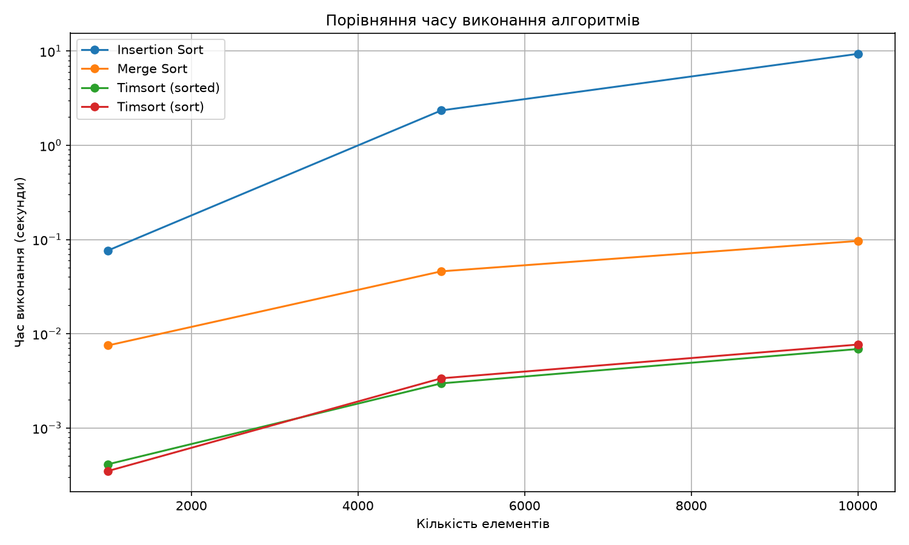
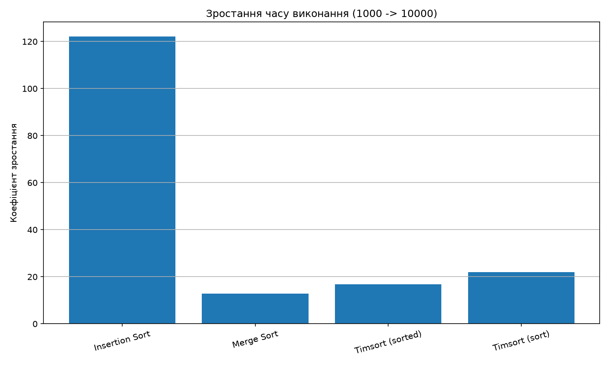

# Домашня робота до тем 3 та 4

Курс **Basic Algorithms and Data Structures 2.0**. Завдання до тем 3 та 4: рекурсія та алгоритми сортування.

## Завдання 1. Сортування файлів за розширеннями

**Файл:** `hw01.py`

Програма рекурсивно обходить вихідну директорію та копіює файли до директорії призначення, розподіляючи їх у папки за розширеннями.

- Директорія призначення за замовчуванням - `dist`.
- Файли без розширення копіюються безпосередньо до директорії призначення.
- Якщо файл із таким іменем уже існує, до нового імені додається номер: `file (1).txt`, `file (2).txt` тощо.
- Програма відображає структуру директорій до та після копіювання й обробляє помилки доступу.

Запуск:

```powershell
python .\hw01.py .\source
```

Або із зазначенням директорії призначення:

```powershell
python .\hw01.py .\source .\output
```

## Завдання 2. Сніжинка Коха

**Файл:** `hw02.py`

Програма малює фрактал "Сніжинка Коха" за допомогою рекурсії та стандартного модуля `turtle`. Рівень рекурсії вводить користувач (рекомендовано від 0 до 5).

Запуск:

```powershell
python .\hw02.py
```

## Завдання 3. Порівняння алгоритмів сортування

**Файли:** `hw03.py`, `insertion_sort.py`, `merge_sort.py`

Порівнюються Insertion Sort, Merge Sort і два варіанти Timsort: `sorted()` та `list.sort()`.

Для тестування використано випадкові масиви з 1 000, 5 000 та 10 000 елементів. Час вимірюється модулем `timeit`. Кожен алгоритм запускається 10 разів на копіях тих самих вхідних даних.

Запуск:

```powershell
python .\hw03.py
```

### Результати вимірювань

Час у таблиці - сумарний час 10 запусків у секундах.

| Алгоритм | 1 000 | 5 000 | 10 000 | Зростання (1 000 → 10 000) |
|---|---:|---:|---:|---:|
| Insertion Sort | 0.07098 | 2.32128 | 9.02743 | 127.17× |
| Merge Sort | 0.00698 | 0.04385 | 0.09399 | 13.47× |
| Timsort (`sorted`) | 0.00035 | 0.00295 | 0.00714 | 20.41× |
| Timsort (`sort`) | 0.00032 | 0.00243 | 0.00665 | 21.05× |

### Графіки





Графіки можна згенерувати окремим скриптом `plot_results.py`. Лише для цього скрипта потрібна бібліотека Matplotlib:

```powershell
python -m pip install matplotlib
python .\plot_results.py
```

Скрипт повторно виконує вимірювання, тому нові графіки можуть трохи відрізнятися від результатів у таблиці. Для виконання самого ДЗ Matplotlib не потрібна.

### Висновки

За результатами тестування найповільнішим виявився Insertion Sort. При збільшенні масиву з 1 000 до 10 000 елементів час його виконання зріс приблизно у 127 разів, що загалом відповідає квадратичній складності $O(n^2)$.

Merge Sort працював значно швидше: час зріс приблизно у 13,5 раза, що узгоджується зі складністю $O(n \log n)$.

Найкращий час показали обидва варіанти Timsort (`sorted()` та `list.sort()`). Отже, для звичайних задач сортування в Python вигідніше використовувати вбудовані засоби. 